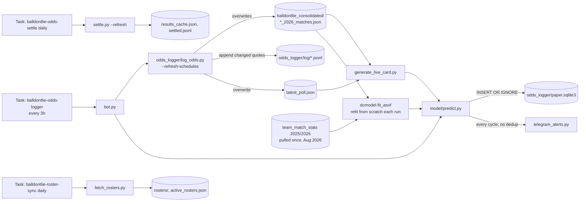
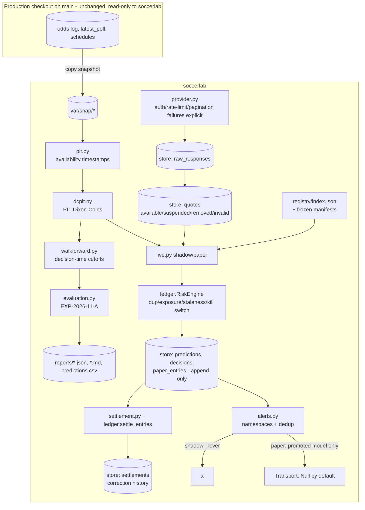

# Architecture

## Before (legacy, still running on `main`)

Properties: no model versioning; predictions are not stored, only flagged
picks; historical evaluation scripts (`backtest/validate/evaluate/strategy/
blend`) share one leaked promoted prior; the CLV report is zero by
construction.

## After (this branch; production untouched)

### Namespaces

| namespace | who writes | may alert | may appear in official performance |
|---|---|---|---|
| legacy-production | legacy bot on `main` | yes (legacy Telegram path) | legacy only |
| shadow | any *challenger* via `soccerlab shadow` | **never** | no |
| paper | only a *promoted* model via `soccerlab paper` | yes, deduplicated, opt-in transport | yes |
| ops | health/ingestion checks | yes, deduplicated per kind/subject/day | n/a |

### Module map

| module | responsibility |
|---|---|
| `timeutil` | aware-UTC parsing; naive timestamps rejected |
| `odds` | conversions, power/proportional de-vig, EV, commission, settlement P&L, quote validity |
| `pit` | point-in-time match store: result_at, xg_at, league membership |
| `dcpit` | legacy likelihood with PIT inputs, PIT promoted prior |
| `walkforward` | weekly refit grid, decision-time selection of fits |
| `metrics` | log-loss, Brier, calibration, class-wise ECE, clustered bootstrap, drawdown |
| `clv` | quote events, closing proxy with age, selection-specific CLV |
| `settlement` | 90-minute 1X2 grading, void/review rules |
| `store` | append-only SQLite layers |
| `ledger` | risk engine, paper entries, settlement, performance |
| `alerts` | namespaced, deduplicated alert formatting/transport |
| `provider` | BallDontLie client (centralised endpoint versions) |
| `manifest`, `legacy_baseline`, `registry` | freeze/verify, model roles |
| `evaluation`, `report` | EXP-2026-11-A |
| `datacheck`, `audit` | data verification, health, static audit |
